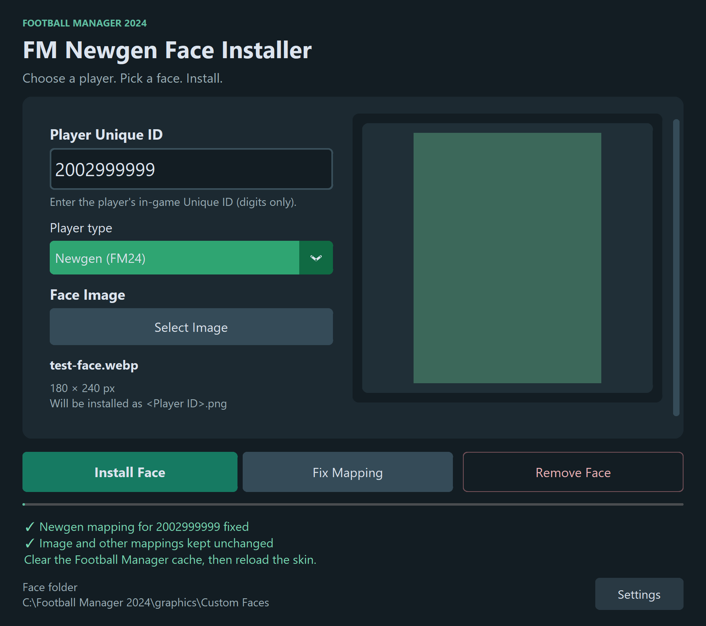

# FM Newgen Face Installer

[](https://github.com/leedontbeshy/FM-Newgen-Face-Installer/actions/workflows/ci.yml)
[](LICENSE)

A small Windows desktop utility for **Football Manager 2024**. Pick an existing
image, enter a player's Unique ID, and install it as `<ID>.png` with the correct
portrait mapping. No face generation, cloud service, telemetry or save-game editing.

[Tiếng Việt](docs/README.vi.md) · [Releases](https://github.com/leedontbeshy/FM-Newgen-Face-Installer/releases) · [Report an issue](https://github.com/leedontbeshy/FM-Newgen-Face-Installer/issues)



The interface follows Windows display scaling. Wide windows use two columns;
narrow windows stack the form vertically. Text and previews grow with available
space, while installation actions stay visible below the scrollable form.

## Download and run

1. Download the Windows x64 ZIP from [Releases](https://github.com/leedontbeshy/FM-Newgen-Face-Installer/releases).
2. Extract the **entire** ZIP.
3. Open `FMNewgenFaceInstaller.exe`. Keep `_internal` beside it.

The portable build includes Python and its dependencies. Windows 10/11 x64 is
the intended platform. Releases are currently **unsigned**: Smart App Control or
enterprise signing policy may block them. Do not disable security protections to
run the app. The release notes report packaging checks; a checksum is not a code
signature. See [Microsoft's signing guidance](https://learn.microsoft.com/en-us/windows/apps/develop/smart-app-control/overview).

## Install a face

1. On first launch, select the custom face folder that Football Manager reads,
   such as `Documents\Sports Interactive\Football Manager 2024\graphics\Custom Faces`.
   It must contain the images and `config.xml` directly. A valid config is created
   on the first installation if one is missing.
2. Enter **Player Unique ID** using digits only. Surrounding whitespace is trimmed.
3. Select **Newgen (FM24)** for a game-generated player, or **Real player** for a
   database player. The app does not guess player type from the ID.
4. Choose **Select Image**. PNG, JPG, JPEG and still WEBP are supported. The picker
   starts in Windows Downloads, then remembers the last image folder.
5. Check the preview and click **Install Face**.
6. Clear the game's cache if needed and reload the skin.

To install another face, enter the next player's ID and select the next image.
You can repeat this in the same app session.

The destination is always `<ID>.png`, never the source filename. PNGs are copied
without recompression; JPEG/WEBP are converted to PNG with original dimensions
and alpha preserved. JPEG EXIF orientation is respected. Only the preview is resized.

**FM24 newgens need `r-` in the target, not the filename:**

```xml
<record from="2002999999" to="graphics/pictures/person/r-2002999999/portrait"/>
```

The image above is `2002999999.png`. Real players use `person/<ID>/portrait`
without `r-`. This convention is documented in the
[NewGAN maintainers' FM24 fix](https://github.com/Maradonna90/NewGAN-Manager/pull/189/files).

| Existing files | Install behavior |
| --- | --- |
| No image or mapping | Install PNG and add one mapping |
| Image and correct mapping | Confirm replacement; config stays byte-for-byte unchanged |
| Mapping but no image | Restore image without an overwrite prompt; config stays unchanged |
| Image but no mapping | Confirm image replacement and mapping creation |
| Legacy real-player target selected as a newgen | Stop and direct you to **Fix Mapping** |
| Cancel confirmation | Leave the image and config unchanged |

### Fix an old newgen mapping

Select **Newgen (FM24)**, enter the ID, and click **Fix Mapping**. After explicit
confirmation, only that mapping's target changes from `person/<ID>/portrait` to
`person/r-<ID>/portrait`. The image and all other bytes remain unchanged. Correct
targets are no-ops; ambiguous duplicates or custom targets are refused.

### Remove a face

Enter the ID and click **Remove Face**; no source image is needed. Confirm removal
of the image and/or its mapping. If neither exists, the app reports **Nothing to
remove**. A missing mapping never causes a config rewrite.

### Settings and shortcuts

**Settings** shows the current folder, **Change Folder**, and **Open Face Folder**.
Settings and bounded error logs are stored under
`%LOCALAPPDATA%\FM Newgen Face Installer`, outside the game folder. The folder
choice is remembered on the next launch.

- `Ctrl+O`: select image.
- `Ctrl+Enter`: install when inputs are valid.

### Reload the Football Manager skin

Open **Preferences → Advanced → Interface** (or search for “skin”). Disable
**Use caching to decrease page loading times**, enable **Reload skin when
confirming changes in Preferences**, then **Confirm / Reload Skin**. If the old
image remains, use **Clear Cache** and reload. Labels vary by language and skin.
The app does not control Football Manager's UI or resolve conflicts with other facepacks.

## How large configs are handled

- Exact `from`-attribute lookup inside the root maps list, read incrementally
  with a bounded buffer; stop as soon as a matching record is found.
- No DOM, whole-file text load, sorting or XML reserialization.
- Preserve existing bytes, order, whitespace, BOM, encoding and CRLF/LF.
- Validate the XML and expected maps tail before mutations.
- Write `config.xml.bak`, stream to `config.xml.tmp`, flush/fsync, validate the
  temp, then atomically replace the config on the same filesystem.
- Stage images and roll them back on ordinary config-commit failures.
- Use an OS folder lock and recheck file fingerprints after confirmation.

The suite exercises synthetic configs with **10,000, 100,000, 250,000 and 500,000
mappings**, including lookup, add, repair, duplicate/no-op and remove operations.
See [architecture](docs/architecture.md) and [verification](docs/verification.md).

## Development

Use Python **3.11+ with Tcl/Tk**, on Windows. From the repository root:

```powershell
python -m venv .venv
.\.venv\Scripts\python.exe -m pip install -r requirements-dev.txt
.\.venv\Scripts\python.exe app.py
```

For source execution without development tools, install `requirements.txt`.
An editable package install is also supported with `python -m pip install -e .`.

```powershell
.\.venv\Scripts\python.exe -m ruff check .
.\.venv\Scripts\python.exe -m ruff format --check .
.\.venv\Scripts\python.exe -m pytest -q
.\.venv\Scripts\python.exe -m pytest tests/test_large_config.py -q -s
.\.venv\Scripts\python.exe tools\smoke_ui.py
```

Tests use temporary synthetic data. A small example is provided at
[`examples/config.xml`](examples/config.xml); no facepack or real player images
are distributed. To validate a local sample without modifying it:

```powershell
.\.venv\Scripts\python.exe tools\verify_sample.py "C:\path\to\config.xml"
```

## Build Windows portable ZIP

```powershell
.\build.ps1
# Use a separate output directory if an older build is open:
.\build.ps1 -OutputDirectory 'dist\preview'
```

Output: `dist\FMNewgenFaceInstaller-win-x64.zip`. The onedir bundle includes Tk,
CustomTkinter assets, Pillow WEBP support and third-party license notices. Building
must be done on Windows. To check the packaged app without real user settings:

```powershell
.\.venv\Scripts\python.exe tools\smoke_exe.py dist\FMNewgenFaceInstaller\FMNewgenFaceInstaller.exe
```

GitHub Actions tests Windows Python 3.11/3.14, builds a portable artifact, and
publishes version-tagged preview releases with SHA-256 checksums.

## Limits and recovery

- Supports one root `record` with a single direct `list id="maps"` as the last
  child. Closing tags must be on separate lines. Ambiguous/compact structures,
  DTDs, unsupported encodings or duplicate targets during remove/repair are refused.
- UTF-8, UTF-16 and common ASCII-compatible single-byte encodings are supported.
- No animated images, cropping, face generation, batch import or cross-facepack
  conflict detection. Preview memory depends on the source image's dimensions.
- Backups/temps need free disk space. `.bak` is the config immediately before the
  most recent config mutation. A small `.fm-face-installer.lock` file stays behind;
  the OS releases its lock automatically when a process ends.
- Do not edit the same config concurrently in another program. Use a local
  filesystem; network-share locking and replacement behavior are not verified.
- Image and config are separate files. Ordinary failures roll back; power loss or
  a forced kill between commits can leave an orphan or missing image. The config
  remains the complete old or complete new file, not a truncated partial write.
- A leftover `config.xml.tmp` is not overwritten automatically. Inspect the
  original and backup, move the temp aside, then retry. Do not promote an unverified
  temp. Recovery images may remain as `.fm-face-*` after an interrupted operation.

## Contributing and license

See [CONTRIBUTING](CONTRIBUTING.md), [security reporting](SECURITY.md), and
[community expectations](CODE_OF_CONDUCT.md). This project's code is released
under the [MIT license](LICENSE); bundled dependencies retain their
[third-party licenses](THIRD_PARTY_NOTICES.md).

Independent community project. Not affiliated with or endorsed by Sports
Interactive or SEGA. Football Manager and associated marks belong to their owners.
